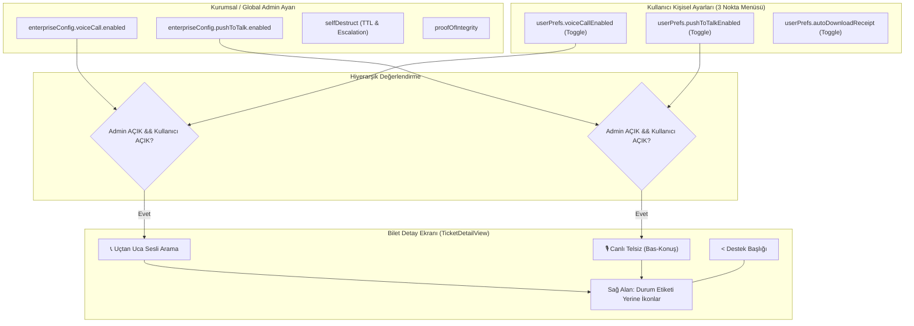

# WhiteDesk "Gelişmiş Özellikler" Modülü ve Kriptografik Entegrasyon Mimarisi (Güncellenmiş Plan)

Bu belge, kullanıcının ek direktifleri doğrultusunda hem kurumsal (Global Admin) hem de kullanıcı bazlı (User Preferences) hiyerarşik yapılandırma ile bilet detay başlığındaki yeni ikon yerleşimini kapsayacak şekilde güncellenmiştir.

---

## 🏛️ Mimari Akış ve Karar Matrisi

---

## 1. Dil ve Terminoloji (Microsoft TR-TR Standardı)

* **`src/locales/tr/settings.json`**:
  * Kullanıcının sunduğu tüm anahtarlar (`menu_title`, `voice_call`, `ptt`, `self_destruct`, `proof_of_integrity`, `actions`).
  * Kullanıcı tercihleri için: `"user_preferences_title": "Gelişmiş Özellik Tercihleri"`, `"user_voice_desc": "Gelen ve giden sesli arama isteklerini etkinleştir"`, `"user_ptt_desc": "Telsiz bas-konuş özelliğini biletlerde göster"`.
* **`src/locales/tr/tickets.json`**:
  * Handshake ve makbuz metinleri.
* **`src/locales/index.ts`**:
  * `settingsTr` modülü `getTranslation` fonksiyonuna entegre edilecek.

---

## 2. 3 Nokta Menüsü (Hem Admin Hem Kullanıcı İçin)

### `HelpDeskScreen.tsx` Başlık Bölümü
* Ana ekran üst barındaki (`styles.topBackHeaderRow`) 3 nokta butonu (`MoreVertical`), daha önce yalnızca `isAdmin === true` durumunda çıkıyordu.
* **Değişiklik:** 3 nokta butonu artık **herkes için (tüm kullanıcılar ve adminler)** görüntülenecektir.
* **Menü İçeriği:**
  * **Yöneticiler için (`isAdmin === true`):**
    * Provizyon Konsolu
    * Lisans
    * Kuruluş Ayarları (Kurumsal Genel + Gelişmiş Özellikler)
    * SDK Entegrasyonları
    * Kişisel Tercihler (Kullanıcı Toggle'ları)
    * Oturumu Kapat
  * **Normal Kullanıcılar için (`isAdmin === false`):**
    * **Gelişmiş Özellikler (Kişisel Tercihler - Toggle menüsü)**
    * Kendinizi Tanımlayın (Rumuz/Unvan)
    * Oturumu Kapat

---

## 3. Bilet Detay Ekranı Düzenlemesi (`TicketDetailView.tsx`)

* **Mevcut Durum:**
  * `< Destek` başlığının sağında `headerButtonlessActions` içerisinde admin için `renderStatusPill`, kullanıcı için kapatma butonu (`Bileti Kapat` / `Yeniden Aç`) duruyordu.
  * Alt mesaj yazma alanında ise telefon ikonu yer alıyordu.
* **Yapılacak Düzenleme:**
  1. `< Destek` başlığının sağındaki durum etiketi / kapatma butonu kaldırılacak.
  2. O alana sağa hizalı olarak **Telefon (`Phone`)** ve **Telsiz / Bas-Konuş (`Mic`)** butonları yerleştirilecek.
  3. **Görünürlük Şartı:**
     * Admin ayarlarında kapalıysa kesinlikle görünmeyecek.
     * Hem Admin ayarlarında hem de Kullanıcı kişisel ayarlarında **birlikte açık durumdaysa** görünecek!
  4. Alt mesajlaşma çubuğundaki mükerrer telefon butonu temizlenecek.
  5. Bilet durumu ve bilet kapatma/yeniden açma işlemi ise biletin kendi detay kartı içerisinden ve uzun basma aksiyon menüsünden yürütülecektir.

---

## 4. Kriptografik Yetenekler ve Yaşam Döngüsü

1. **Uçtan Uca Sesli Arama (CallOfferHandshake):**
   * Üstteki telefon ikonuna basıldığında `policy === 'mutual_consent'` ise karşı tarafa çağrı el sıkışma kartı/penceresi gönderilir:
     `[Yönetici/Kullanıcı Sesli Görüşme Başlatmak İstiyor] -> [Kabul Et] / [Reddet]`.
2. **Canlı Telsiz (Bas-Konuş - PTT):**
   * Üstteki mikrofon ikonuna basılı tutulduğunda 15 saniyeye kadar ses patlaması kaydedilir, bilet oturum anahtarıyla şifrelenir ve RAM'den temizlenir.
3. **Kendini İmha Eden Talepler (TTL):**
   * Kapatılan biletlerde belirlenen saat dolduğunda `CryptoService.destroyTicketSessionKey(ticketId)` ile yerel anahtar kalıcı olarak imha edilir.
4. **Değişmezlik İspatı (Merkle Receipt Generator):**
   * Bilet kapandığında tüm mesaj hash'leri dizilerek Merkle Kök Özeti çıkarılır ve P-256 imzalı standart `.json` makbuzu üretilir.
