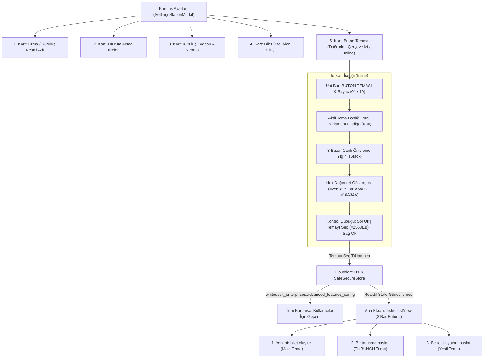

# 🎨 Kuruluş Ayarları Google Teması & Buton Teması Seçici Uygulama Planı (Revize)

> [!NOTE]
> Bu plan, kullanıcının `/grill-me` mülakatında onayladığı iki kritik mimari karara göre güncellenmiştir:
> 1. **Doğrudan Çerçeve İçi (Inline Kart):** Ekstra bir pop-up/modal açılmayacak; 19 paletlik tema seçici, buton önizlemeleri ve ok kontrolleri doğrudan Kuruluş Ayarları ekranının en altındaki 5. Google kartının içerisine gömülecektir.
> 2. **Kurumsal Düzeyde Senkronizasyon (Cloudflare D1 & SafeSecureStore):** Seçilen tema yalnızca bu cihaza özgü kalmayacak; Cloudflare D1 (`whitedesk_enterprises.advanced_features_config.buttonThemeId`) üzerinden kuruluşun tüm personeli ve yöneticileri için kurumsal olarak geçerli olacaktır.

---

## 🏛️ Mimari İş Akışı ve Bileşen Hiyerarşisi

---

## 1. Kuruluş Ayarları Google Teması Dönüşümü (`SettingsStationModal.tsx`)

Mevcut düzensiz ve karmaşık liste yapısı yerine Google Settings / Material 3 standardında **5 bağımsız kart çerçevesi (`googleSectionCard`)** oluşturulacaktır:

* **Zemin Stili:** Modal içeriği yumuşak Google açık gri zeminine (`#F8FAFC`) alınır.
* **Kart Standartları:**
  - `backgroundColor: '#FFFFFF'`
  - `borderRadius: 16`
  - `borderWidth: 1`, `borderColor: '#E2E8F0'`
  - `padding: 16`
  - `marginBottom: 14`
  - `shadowColor: '#000'`, `shadowOffset: { width: 0, height: 1 }`, `shadowOpacity: 0.04`, `shadowRadius: 4`, `elevation: 1`
* **Kart İçerik Dağılımı:**
  1. 🏢 **Firma / Kuruluş Resmi Adı Kartı:** Başlık, açıklama, açık gri arkaplanlı input ve mavi Güncelle butonu.
  2. 🔐 **Oturum Açma İlkeleri Kartı:** İki kelime ad-soyad zorunluluğu Switch'i ve kapalı durum uyarı notu.
  3. 🖼️ **Kuruluş Logosu Kartı:** Logo önizleme alanı, hizalama butonları (Sol/Orta/Sağ), kırpma ve kaldırma aksiyonları.
  4. 📋 **Bilet Özel Alan Girişi Kartı:** Hızlı çip şablonları, tanımlı alanlar listesi, yeni alan ekleme satırı.
  5. 🎨 **Buton Teması Kartı (GÖMÜLÜ İNLİNE):** En alta eklenen canlı kontrol ve önizleme kartı.

---

## 2. Buton Teması Kartı İç Yapısı (Doğrudan Çerçeve İçi)

Kuruluş ayarlarının en altında yer alacak 5. kartın doğrudan içinde:
* **Kart Başlık Çubuğu:**
  - Sol: `BUTON TEMASI` (13px, bold, kurumsal gri `#334155`, letterSpacing: 0.5)
  - Sağ: `01 / 19` Sayaç rozeti (Monospace, `#64748B`)
* **Aktif Tema Adı:**
  - Ortalanmış, 14px bold metin (Örn: `Parlament / İndigo (Katı)`).
* **3 Buton Canlı Önizleme Yığını (Stack):**
  1. **`+ Yeni bir bilet oluştur`** (Mavi palet stili, sağda yukarı ok).
  2. **`Bir tartışma başlat`** (Turuncu palet stili, solda mesaj ikonu, sağda ok).
  3. **`Bir telsiz yayını başlat`** (Yeşil palet stili, solda telsiz ikonu).
* **Hex Kodları Göstergesi:**
  - Seçili temanın 3 hex kodu (Örn: `#2563EB`, `#EA580C`, `#16A34A`).
* **Alt Kontrol Çubuğu:**
  - **Sol Ok Butonu:** Önceki sete geçer (40x40px, beyaz zemin, `#CBD5E1` kenarlık).
  - **Temayı Seç Butonu:** Siyah değil; WhiteDesk kurumsal canlı mavisi (`#2563EB`, basıldığında `#1D4ED8`). Üzerinde onay ikonu ve `"Temayı Seç"`. Tıklanınca yeşile dönerek (`#15803D`) `"Seçildi ✓"` olur; hem D1'e yazar hem de ana ekrandaki butonları anında günceller.
  - **Sağ Ok Butonu:** Sonraki sete geçer.

---

## 3. 40 Paletlik Tema Kataloğu (Grup 1 ve Grup 2) (`buttonThemeService.ts`)

Ekranın başında **`[ 1 ]`** ve **`[ 2 ]`** grup seçici yer alır. Her grupta 20'şer adet palet bulunmaktadır (`01 / 20`).

### 1. Grup (20 Palet - Zengin Dinamik Spektrum)

| No | Tema Adı | Bilet Butonu (Mavi) | Tartışma Butonu (Turuncu) | Telsiz Butonu (Yeşil) |
| :---: | :--- | :---: | :---: | :---: |
| **01** | **Parlament / İndigo (Katı) [Varsayılan]** | `#2563EB` | **`#EA580C`** | `#16A34A` |
| **02** | Derin İndigo-Mavi | `#2F6FED` | **`#EB8538`** | `#2BAE78` |
| **03** | Safir Pastel | `#3B79C9` | **`#E07A5F`** | `#4E9B78` |
| **04** | Canlı Tech Mavi | `#3B82F6` | **`#F97316`** | `#10B981` |
| **05** | Klasik Dengeli Mavi | `#4A90E2` | **`#F38240`** | `#38A169` |
| **06** | Kobalt Pastel | `#4C82E6` | **`#E88452`** | `#3FA87E` |
| **07** | **Kurumsal Mavi & Bakır** | **`#2E75D8`** | **`#C85A32`** | **`#269B69`** |
| **08** | Gök / Azure Mavi | `#3A8FC4` | **`#DC7B62`** | `#559E84` |
| **09** | Duru Gök Pasteli | `#4293C3` | **`#DD8066`** | `#54A086` |
| **10** | Uçuk Buzul Mavisi | `#4D96BD` | **`#DE866D`** | `#5AA389` |
| **11** | Sisli Göl Pasteli | `#5394B1` | **`#DD8972`** | `#5C9E86` |
| **12** | Durgun Kıyı Pasteli | `#4F8DA6` | **`#DE8369`** | `#53977F` |
| **13** | Buz Mavisi & Amber | `#5188A6` | **`#E07A5F`** | `#4D9078` |
| **14** | Dumanlı Slate Mavisi | `#5D7A88` | **`#DE8F6E`** | `#6BA292` |
| **15** | Vintage Mat Mavi | `#557A95` | **`#D9834F`** | `#608871` |
| **16** | Pastel Şeker Mavisi | `#639FAB` | **`#E28456`** | `#5BA88E` |
| **17** | Puslu Mineral Mavi | `#6C8299` | **`#D38260`** | `#5B9279` |
| **18** | Çerçeveli Saf Mavi (Ghost) | `#FFFFFF` (`#2B6CB0`) | **`#FFFFFF` (`#DD6B20`)** | `#FFFFFF` (`#2F855A`) |
| **19** | Açık Göl Mavisi Dolgu | `#DCEAF4` | **`#FEE8D8`** | `#DBEFE2` |
| **20** | Buzul Tint (En Açık Zemin) | `#EBF3FC` | **`#FEF0E7`** | `#EAF7EF` |

### 2. Grup (20 Palet - WhiteDesk Öz Mavi & Tondaş Armoni)

*Mavi renk uygulamanın `#2563EB` omurgasına sadık tondaştır; turuncu ve yeşil tonlar abes kontrast olmadan profesyonelce dengelenmiştir.*

| No | Global ID | Tema Adı | Bilet Butonu (Mavi) | Tartışma (Kiremit/Bakır) | Telsiz (Yeşil/Orman) |
| :---: | :---: | :--- | :---: | :---: | :---: |
| **01** | 21 | Derin Kurumsal Mavi | `#1D4ED8` | `#C2410C` | `#15803D` |
| **02** | 22 | WhiteDesk Öz Mavi | `#2563EB` | `#D97706` | `#059669` |
| **03** | 23 | Asil Safir Mavi | `#215BD6` | `#CA521B` | `#1B8749` |
| **04** | 24 | Prestij Mavi | `#2B66E2` | `#CF5A24` | `#228B52` |
| **05** | 25 | Modern Kurumsal Mavi | `#326EE6` | `#C8632E` | `#25965C` |
| **06** | 26 | Parlak İş Mavisi | `#3B7DF0` | `#D26D34` | `#2CA366` |
| **07** | 27 | Canlı Tondaş Mavi | `#4185F5` | `#D7743E` | `#32AC70` |
| **08** | 28 | Duru Kurumsal Mavi | `#4F8DF5` | `#DB7D4A` | `#39B57B` |
| **09** | 29 | İpeksi Tondaş Mavi | `#5C96F7` | `#E08757` | `#43BD85` |
| **10** | 30 | Yumuşak Gökyüzü Mavisi | `#6B9FF8` | `#E49064` | `#4DC590` |
| **11** | 31 | Dumanlı Kurumsal Slate | `#3B5B8C` | `#B25732` | `#3A7359` |
| **12** | 32 | Grafit Mavi Tondaş | `#38547C` | `#A8502D` | `#346850` |
| **13** | 33 | Çelik Kurumsal Mavi | `#42618F` | `#B65F3A` | `#3E795E` |
| **14** | 34 | Sisli Lacivert Slate | `#3F587A` | `#A45B3A` | `#386551` |
| **15** | 35 | Mat Mineral Mavi | `#4B678E` | `#B36949` | `#467862` |
| **16** | 36 | Puslu İş Mavisi | `#557199` | `#B87355` | `#4D826C` |
| **17** | 37 | İnce Gri Kurumsal Tint | `#607B9E` | `#BC7E62` | `#558B75` |
| **18** | 38 | Çerçeveli Kurumsal Slate (Ghost) | `#FFFFFF` (`#3B5B8C`) | `#FFFFFF` (`#B25732`) | `#FFFFFF` (`#3A7359`) |
| **19** | 39 | Açık Slate Mavi Dolgu | `#E2E8F0` | `#FFEDD5` | `#DCFCE7` |
| **20** | 40 | İnce Kurumsal Haze | `#EEF2F6` | `#FFF7ED` | `#F0FDF4` |

---

## 4. Bilet Açılışı Kategori Kilidinin Kaldırılması

Admin bilet açılışında daha önce zorlanan sabit `"TheWhite Uygulama & Mimari Desteği"` (`thewhite` / `global_admin`) kategori kilidi kaldırılmış; hem yönetici hem kullanıcı bilet oluştururken firmanın dinamik kategorilerini (`availableCategories`) özgürce seçebilecek hale getirilmiştir.

---

## 4. Ana Ekran Bar Butonları Güncellemesi (`TicketListView.tsx`)

* `styles.fluidDiscussionPurpleBtn` (eski mor `#7C3AED` stil) tamamen kaldırılarak / revize edilerek seçili temanın **turuncu** paletine (`activeButtonTheme.disc.bg`) bağlanacaktır.
* 3 buton da (`fluidNewTicketBtn`, `fluidDiscussionBtn`, `fluidRadioBroadcastBtn`) aktif temanın arka plan, yazı rengi, kenarlık rengi ve ikon renklerini dinamik olarak alacaktır.
* İsimler uygulamanın standart i18n etiketlerini kullanacaktır:
  - `helpdesk.create_new_ticket_btn` ("Yeni bir bilet oluştur")
  - `helpdesk.start_discussion_btn` ("Bir tartışma başlat")
  - `helpdesk.start_radio_broadcast_btn` ("Bir telsiz yayını başlat")

---

## 5. Değiştirilecek Dosyalar

1. **`src/services/helpdesk/buttonThemeService.ts`** *(20 palet tanımı, D1 senkronizasyonu ve SafeSecureStore önbelleği)*
2. **`src/components/helpdesk/types.ts`** *(AdvancedFeaturesConfig içine `buttonThemeId?: number` eklenmesi)*
3. **`src/components/helpdesk/station/SettingsStationModal.tsx`** *(Google kart teması dönüşümü + 5. Inline Buton Teması kartı)*
4. **`src/components/helpdesk/views/TicketListView.tsx`** *(3 butonun seçili temaya ve turuncu tartışma butonuna bağlanması)*
5. **`src/screens/HelpDeskScreen.tsx`** *(Kurumsal buton temasının çekilmesi ve dinamik olarak sunulması)*
6. **`whitedesk_schema.sql` & `cloudflare-worker/schema.sql`** *(Şema bütünlüğü kontrolü)*
