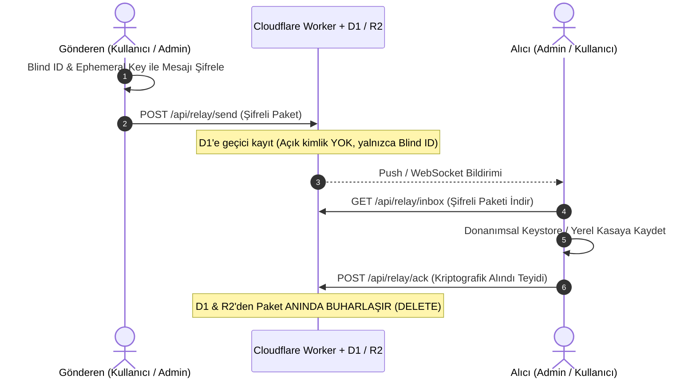

# WhiteDesk Sovereign Cloudflare Mimari Planı (D1 + R2 + Buharlaşma)

## 1. Mimari Vizyon ve Temel İlkeler

WhiteDesk ekosistemi, **"Sıfır Kişisel Veri (Zero Personal Data)", "Sıfır Kalıcı Sunucu İzi (Zero Data Retention)"** ve **"Egemen Şifreleme (Sovereign Cryptography)"** temelleri üzerine inşa edilmiştir.

Sunucular ve bulut ortamı hiçbir zaman kalıcı bir veritabanı veya mesaj arşivi değildir; yalnızca şifreli paketlerin alıcıya ulaşana kadar bekletildiği bir **"Geçici Aktarım / Buharlaşma Havuzu (Ephemeral Relay)"**dur.



---

## 2. Temel Prensipler

1. **Açık Kimlik Yasağı ve Kökten `blind_id` Üretimi (Strict Blind ID Only at Root):**
   * Ham `white_id` (açık anahtar hex) güvenlik açığı oluşturduğundan hiçbir şekilde ağ üzerinden bir yere gönderilemez ve veritabanı/D1 tablolarında tutulamaz.
   * Kimlik üretilen her kök noktada (`cryptoService.ts`, `crypto-vault.service.ts`, `helpDeskAuthService.ts`, `cloudflare-worker`) yalnızca algoritma değişikliği ile doğrudan `blind_id` (`'blind_' + SHA256('whitedesk_global_salt_v1:' + raw).substring(0, 32)`) üretilir ve tüm sistem yoluna tekil olarak `blind_id` ile devam eder.
   * İletişimde (arama, bas-konuş, telsiz, mesajlaşma) `whitedesk_user_bindings` tablosuna bakılmaz; tek kural **bilet kartındaki `blind_id`** değeridir.
   * Sistemde limit ve fatura tüketen periyodik **polling** yasaktır; alıcı cihaz yalnızca FCM Push ile uyanır.
2. **Mesaj Buharlaşması (Vaporization via ACK):**
   * Alıcı cihaz şifreli paketi okuyup yerel kasasına mühürlediği anda sunucuya bir `ACK` (Acknowledgement) paketi döner.
   * ACK sunucuya ulaştığı anda kayıt Cloudflare D1 ve R2 üzerinden anında silinir.
3. **Zaman Aşımı Güvencesi (TTL Auto-Purge):**
   * Alıcı cihaz çevrimdışı olsa bile hiçbir mesaj D1 üzerinde maksimum 72 saatten uzun kalamaz. 72 saat dolduğunda Cloudflare Cron Trigger ile otomatik olarak silinir.
4. **Cihaz İçi Egemenlik (Local Keystore Vault):**
   * Gerçek mesaj geçmişi yalnızca kullanıcının ve yöneticinin kendi cihazındaki Hardware Keystore ve şifrelenmiş yerel SQLite kasasında saklanır.

---

## 3. Cloudflare Katmanları ve Görev Dağılımı

### A. Cloudflare D1 (Geçici Mesaj Havuzu)
* SQLite tabanlı dağıtık edge veritabanı.
* Yalnızca teslim edilmeyi bekleyen geçici bilet ve mesaj paketlerini barındırır.
* `whitedesk_d1_relay` şeması:

```sql
CREATE TABLE IF NOT EXISTS transient_messages (
    id TEXT PRIMARY KEY,                       -- Kriptografik rastgele paket ID
    ticket_id TEXT NOT NULL,                   -- Bilet referansı (Blind ID)
    recipient_blind_id TEXT NOT NULL,          -- Alıcının kör kimliği (İndexli)
    sender_blind_id TEXT NOT NULL,             -- Gönderenin kör kimliği
    encrypted_payload TEXT NOT NULL,           -- Uçtan uca şifreli mesaj gövdesi
    attachment_r2_key TEXT,                    -- Varsa R2 dosya anahtarı
    created_at INTEGER NOT NULL,               -- Zaman damgası
    expires_at INTEGER NOT NULL                -- TTL bitişi (Örn: created_at + 72h)
);

CREATE INDEX IF NOT EXISTS idx_transient_recipient 
ON transient_messages(recipient_blind_id);

CREATE INDEX IF NOT EXISTS idx_transient_ticket 
ON transient_messages(ticket_id);
```

### B. Cloudflare R2 (Büyük Ek & Belge Havuzu)
* S3 uyumlu nesne depolama.
* Fotoğraflar, loglar ve ekli belgeler istemcide şifrelendikten sonra R2'ye yüklenir.
* Alıcı dosyayı indirdiğinde veya ACK gönderdiğinde nesne anında R2'den yok edilir.

### C. Cloudflare Workers (Merkezi API ve Yönlendirme)
* Bilet oluşturma, mesaj aktarımı, ACK doğrulama ve dosya presigned URL üretimini yöneten hafif ve küresel edge worker.

---

## 4. API Uç Noktaları (Endpoints)

| Metot | Uç Nokta | Açıklama |
| :--- | :--- | :--- |
| `POST` | `/api/relay/send` | Şifreli bilet veya yanıt paketini D1 kuyruğuna bırakır. |
| `GET` | `/api/relay/inbox` | Cihaza ait bekleyen şifreli mesajları çeker (`recipient_blind_id` ile). |
| `POST` | `/api/relay/ack` | Alınan mesajın ID'sini bildirir; D1 ve R2'deki kayıt **derhal silinir**. |
| `POST` | `/api/relay/upload-url` | R2 için tek kullanımlık şifreli yükleme adresi üretir. |
| `POST` | `/api/relay/cleanup-cron` | Süresi dolan (TTL) teslim edilmemiş paketleri otomatik imha eder. |

---

## 5. Neon Veritabanının Tasfiyesi

Geçici prototip aşamasında kullanılan Neon PostgreSQL altyapısının rolü sınırlandırılacaktır:
* **Neon'da Kalacaklar:** Yalnızca statik kurumsal firma kayıtları (Tenant Registry, örn: `enterprise_blind_id`, genel ayarlar).
* **Neon'dan Kaldırılacaklar:** Tüm bilet mesajları (`whitedesk_ticket_messages`), kullanıcı içerikleri ve konuşma kayıtları Neon'dan tamamen arındırılacak; buharlaşma havuzuna (D1) devredilecektir.

---

## 6. Mobil İstemci Uygulama Adımları

1. **`src/services/apiClient.ts`:**
   * Cloudflare Worker uç noktalarına bağlanacak `sendRelayMessage`, `fetchRelayInbox` ve `confirmRelayAck` metotlarının eklenmesi.
2. **`src/services/helpDeskService.ts`:**
   * Doğrudan Neon SQL çalıştırmak yerine mesaj gönderme ve çekme işlemlerinin Cloudflare Worker relay'ine bağlanması.
   * Gelen mesajların yerel `SafeSecureStore` / SQLite kasasına yazılması ve anında `confirmRelayAck` ile sunucudan buharlaştırılması.
3. **Bilet Listesi & Arama:**
   * Bilet ve mesaj listesinin uzak sunucu sorgusu yerine, cihazın yerel kasasından okunacak şekilde yeniden yönlendirilmesi.
