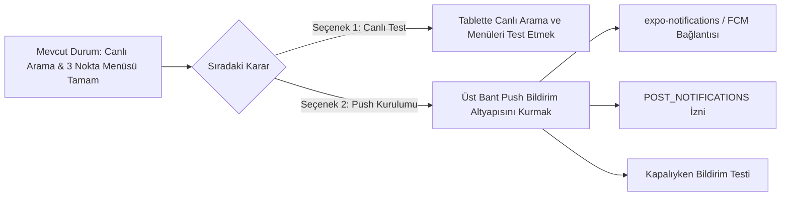

# WhiteDesk İletişim, Arama ve Bildirim Mimarisi: Durum ve Plan Raporu

Bu belge, son yapılan geliştirmeleri netleştirmek; **"Uygulama İçi Sesli Arama İzin/Handshake Süreci"** ile **"İşletim Sistemi Seviyesinde Üst Bant Push Bildirimleri"** arasındaki farkı ve yol haritasını özetlemektedir.

---

## 1. Kavramsal Ayrım: İki Ayrı Dünya

Kullanıcı ile Admin arasındaki iletişim iki farklı katmandan yürür:

| Kriter | 1. Katman: Uygulama İçi Canlı Arama (WebRTC) | 2. Katman: Üst Bant Bildirimi (OS Push Notification) |
| :--- | :--- | :--- |
| **Kapsam** | İki taraf da **uygulamadayken** yapılan uçtan uca sesli görüşme. | Uygulama **kapalıyken/arka plandayken** telefona düşen mesaj veya çağrı uyarısı. |
| **Gereken İzin** | **Mikrofon İzni** (`RECORD_AUDIO`) & Kurumsal/Kullanıcı Tercih İzni. | **Android Bildirim İzni** (`POST_NOTIFICATIONS`) & FCM Token. |
| **İletişim Kanalı** | Ephemeral Sinyalleşme (`/api/signal`) + WebRTC P2P (Stun/Turn). | Google FCM (Firebase Cloud Messaging) / Apple APNs. |
| **Ekrandaki Görünüm** | Tam ekran pastel cam efektli **`CallScreenModal`**. | Telefonun en üst bildirim çekmecesi (Status bar / Head-up banner). |

---

## 2. Az Önce Ne Yaptık? (Tamamlanan Kısım: Katman 1)

Az önce tamamen **Uygulama İçi Canlı Sesli Arama (WebRTC)** sürecini onardık ve kusursuzlaştırdık.

### Yapılanlar:
1. **Bilet Detayındaki 3 Nokta Menü:**
   * Detay ekranında render edilmediği için görünmeyen `TicketActionModal` detay görünümüne monte edildi. Artık bilet silme, imha sayacı başlatma vb. menüler anında açılıyor.
2. **Arama İsteği (Call Request Handshake):**
   * Eskiden arayan bastığında ekranda hiçbir şey olmuyor, aranan tarafta ise minik bir alt sheet diğer pencerelerin altında kayboluyordu.
   * **Düzeltildi:** Arayan bastığı an tam ekran **`CallScreenModal`** açılıyor (*"Görüşme İsteği İletiliyor..."*).
   * Aranan tarafta doğrudan zil sesi çalıyor ve tam ekran **`CallScreenModal`** açılıyor (*"Gelen Sesli Görüşme Talebi"* - Yeşil *"Yanıtla"*, Kırmızı *"Reddet"*).
3. **Otomatik Bağlantı (Auto-Connect):**
   * Aranan kişi *"Yanıtla"* dediği anda, arayana önceden çıkan *"Aramayı başlatmak ister misiniz?"* şeklindeki ikinci gereksiz popup kaldırıldı.
   * Karşı taraf kabul ettiği an arama **doğrudan WebRTC üzerinden bağlanıyor ve ses açılıyor**.
4. **Kişisel Sinyal Kanalı:**
   * Bilet listesindeki sadece ilk 3 bileti tarayan sınır kaldırıldı; doğrudan kullanıcının `blind_id` odasına hızlı sinyal fırlatıldı.

> [!NOTE]
> **Özetle:** Her iki taraf da uygulamayı açtığında veya ön plandayken birbirini araması, zil sesinin çalması, kabul/red ve sesli konuşma akışı şu an **tamamen hazır ve çalışır durumda**.

---

## 3. Henüz Yapılmayan / Sıradaki Adım: Katman 2 (Üst Bant Push Bildirimleri)

Kullanıcının veya yöneticinin **uygulaması kapalıyken** telefonun üstünden:
- *"Ahmet Bey biletinize yeni bir yanıt yazdı."*
- *"Destek Operatörü sesli arama başlattı."*
şeklinde bildirim gelmesi **ayrı bir native altyapı gerektirir**.

### Mevcut Durum:
* Kod tabanında backend'e bildirim isteği atan fonksiyonlar (`apiClient.sendHelpDeskPushNotification`) yazılıdır.
* Ancak telefon tarafında **Firebase Cloud Messaging (FCM)** veya **`expo-notifications`** kütüphanesi henüz entegre edilmemiştir.
* `google-services.json` henüz Android projesinde yoktur.
* Bu yüzden uygulama tamamen kapalıyken üst banttan bildirim henüz düşmez.

---

## 4. Şimdi Ne Yapacağız? (Adım Adım Yol Haritası)

1. **Önce Test:** İsterseniz az önce tablete kurduğumuz sürümde **3 nokta menüsünü** ve **arama isteği/kabul akışını** deneyip her şeyin yerli yerine oturduğunu görebilirsiniz.
2. **Ardından Push:** Eğer hazırsanız, **uygulama kapalıyken üst banttan bildirim düşürme** sürecine (FCM / expo-notifications entegrasyonu) sırasıyla geçebiliriz.
