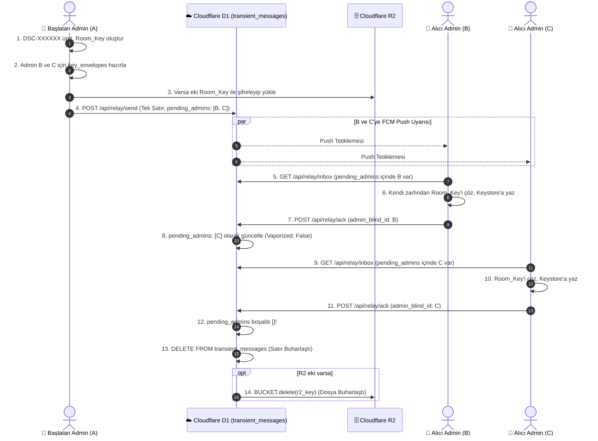

Giriş:
1. Yeni destek bileti iconuyla herkes bir üste bilet iletir. Çoğunlukla kullanıcılar adminlerin hepsine. Ama adminler bilet açtığında global admine gider. Global admin bilet açtığında varsa founder a gider. Zaten founder ytoksa global adminde bir bilet oluştur butonu çıkmaz.  2. Bir tartışma başlat butonu ise global admin ya da adminler tarafoından adminler arası bir tartışma için oluşturulur.


# 📢 WhiteDesk: Açık Tartışma (Discussion) Mimari ve Süreç Şartnamesi

Bu doküman; WhiteDesk sıfır-bilgi (Zero-Knowledge / E2EE) mimarisinde yöneticiler (Bölüm Admini, Global Admin, Kurucu) arasında yürütülen **Açık Tartışma (Discussion)** süreçlerini, tekil `transient_messages` tablosu üzerindeki **Shared Room Key (Paylaşımlı Oda Anahtarı)** modelini ve **Burn-on-ACK** buharlaşma yaşam döngüsünü şartnameler.

---

## 🏛️ 1. Mimari Bağlam ve Temel Kurallar

1. **Tek Tablo (`transient_messages`) Kuralı:**
   - Standart destek biletleri (`TKT-XXXXXX`) ile adminler arası açık tartışmalar (`DSC-XXXXXX`) aynı geçici aktarım havuzunu (`transient_messages`) ve aynı Cloudflare R2 bucket yapısını kullanır.
   - Bulutta kalıcı hiçbir `tickets` tablosu tutulmaz; veriler yalnızca adminlerin kendi cihazlarındaki donanımsal Keystore kasasında (`keystoreTicketVault`) saklanır.
   - Tepe yapı **Workspace** (`tenant_blind_id`), alt birimler **Unit** (`org_id`) olarak adlandırılır.

2. **E2EE & Shared Room Key (Paylaşımlı Oda Anahtarı):**
   - Tartışmayı başlatan admin cihazında rastgele bir simetrik 256-bit `Room_Key` üretir.
   - Bu `Room_Key`, ilgili Workspace/Unit kapsamındaki tüm aktif adminlerin açık anahtarlarıyla ayrı ayrı şifrelenerek `key_envelopes` JSON dizisine eklenir.
   - Tartışma mesajı ve R2 dosya eki bu tekil `Room_Key` ile şifrelenir.
   - **Tek Satır Yazma İlkesi:** 10 adminli bir kurumda 9 ayrı satır `INSERT` edilmez; D1'e yalnızca **TEK BİR SATIR** basılır.

3. **Kendi Kendini Onaran Tartışma (Self-Healing Upsert):**
   - Tartışma geçmişi ve `Room_Key` adminlerin kendi telefonlarında yaşar.
   - Sunucudaki geçici kayıtlar ACK ile tamamen buharlaşmış olsa bile tartışma istemcide ölmez.
   - Bir admin günler sonra aynı tartışma kimliği (`thread_id` / `DSC-XXXXXX`) altına yeni bir mesaj gönderdiğinde; Worker sunucuda eski oturumu aramaksızın istemcinin gönderdiği `thread_id` ve `key_envelopes` ile yeni bir kuyruk satırı açarak diğer adminlere iletir.

4. **Burn-on-ACK ve Maksimum SLA Buharlaşması:**
   - Her tartışma satırında henüz teslim almamış adminlerin kör kimliklerini tutan `pending_admins` JSON dizisi bulunur.
   - Her admin istemcisi mesajı çekip yerel kasasına mühürlediğinde sunucuya `ACK` gönderir.
   - Cloudflare Worker, gelen ACK ile o adminin `blind_id`'sini `pending_admins` listesinden düşürür.
   - `pending_admins` dizisi boşaldığı (`[]`) milisaniyede satır D1'den ve varsa dosya eki R2'den **anında buharlaştırılır (DELETE)**.
   - Çevrimdışı kalan adminler olursa, `expires_at` (Max SLA) süresi dolduğu an satır otomatik imha edilir.

---

## 🗄️ 2. Veritabanı Şeması (`transient_messages`)

Cloudflare D1 üzerindeki `transient_messages` tablosunun yapısı:

```sql
CREATE TABLE IF NOT EXISTS transient_messages (
  id TEXT PRIMARY KEY,                               -- msg_xxx benzersiz aktarım ID'si
  ticket_id TEXT NOT NULL,                           -- DSC-XXXXXX (veya TKT-XXXXXX)
  ticket_type TEXT DEFAULT 'ticket',                 -- 'ticket' | 'discussion'
  thread_id TEXT,                                    -- Tartışma oturumunu birbirine bağlayan ortak ID
  recipient_blind_id TEXT NOT NULL,                  -- Workspace/Tenant Blind ID (ent_xxx)
  sender_blind_id TEXT NOT NULL,                     -- Mesajı gönderen adminin Blind ID'si
  encrypted_payload TEXT NOT NULL,                   -- Room_Key ile şifrelenmiş mesaj içeriği
  key_envelopes TEXT,                                -- [{"admin_blind_id":"...","encrypted_room_key":"..."}]
  pending_admins TEXT,                               -- Henüz ACK göndermemiş adminler: ["blind_1", "blind_2"]
  attachment_r2_key TEXT,                            -- Varsa R2'deki şifreli dosya eki
  created_at INTEGER NOT NULL,                       -- Oluşturulma zaman damgası (ms)
  expires_at INTEGER NOT NULL                        -- Otomatik imha zamanı (Max SLA)
);
```

---

## 🔄 3. Yaşam Döngüsü ve İş Akış Şeması



---

## 💬 4. Tartışma İçi Yanıt (Reply) ve Self-Healing Catch-Up Akışı

1. **Yanıtın Tek Satır Olarak İletimi:**
   - Tartışmaya katılan herhangi bir yönetici yanıt yazdığında (`replyToTicket`), cihaz biletin `is_discussion === true` olduğunu algılar.
   - Şirketteki diğer aktif adminlerin `blind_id`'lerini toplar (`pending_admins`).
   - Yine **tek bir satır** olarak `/api/relay/send` endpoint'ine postalar (`ticket_type: 'discussion'`, `thread_id: 'DSC-XXXXXX'`).

2. **Self-Healing Catch-up (Geçmiş Mesaj & Başlık Onarımı):**
   - Sunucudaki D1 satırları çoktan buharlaşmışken uzun süre sonra bir admin yeni bir mesaj yazdığında, o ana kadar çevrimdışı kalmış ve tartışmayı hiç görmemiş adminlerin bağlamı kaçırmaması için:
     - Yanıtı gönderen adminin yerel Keystore kasasından **bilet başlığı (`ticket_header`)** ve **son 10 mesajlık konuşma geçmişi (`catchup_history`)** pakete eklenir.
     - Çevrimdışı kalmış admin telefonunu açtığında, eğer cihazında bu tartışma hiç yoksa; önce `ticket_header` ile tartışma kartını yerel Keystore'da oluşturur, ardından `catchup_history` içindeki son 10 mesajı ve en yeni yanıtı içeri alarak konuşmayı anında eksiksiz canlandırır.
     - Zaten konuşmada olan online adminler mükerrer mesajları `id` kontrolü ile pas geçer.

3. **Dinamik SLA ve Orphan R2 Temizliği:**
   - Tartışma mesajları için `expires_at` süresi sabit 72 saat yerine, Workspace'in kayıtlı SLA ayarına (`escalation.slaHours` / `selfDestruct.retentionAfterResolvedHours`) göre dinamik hesaplanır.
   - Adminlerden biri çevrimdışı kalıp `ACK` vermezse, bu SLA süresi dolduğunda Cloudflare Worker saatlik Cron'u (`scheduled`) devreye girer:
     - Süresi dolmuş satırların dosya eklerini (`attachment_r2_key`) önce Cloudflare R2'den siler.
     - Ardından D1 satırını kalıcı olarak buharlaştırır; sunucuda yetim dosya veya veritabanı artığı bırakmaz.

---

## 🛡️ 5. Güvenlik ve Performans Kazanımları

| Özellik | Sağlanan Avantaj |
| :--- | :--- |
| **Sıfır Sunucu İzi** | Tartışma bittiğinde sunucuda tek bir bayt dahi mesaj, başlık veya ek kalmaz. |
| **D1 Kota Tasarrufu** | Her mesaj için $N$ adet `INSERT`/`DELETE` yerine **yalnızca 1 adet `INSERT`** ve hafif `UPDATE` yapılır. |
| **Mobil Pil & Bant Genişliği** | Ekli dosyalar her admin için ayrı ayrı şifrelenip yüklenmez; tek bir R2 nesnesi üzerinden ortak oda anahtarıyla paylaşılır. |
| **Tam Self-Healing (Catch-up)** | Sunucudaki tüm satırlar silinse dahi, adminlerden biri yeniden yazdığında kaçıran adminler bilet başlığı ve son 10 mesajlık geçmişle birlikte tartışmaya eksiksiz geri döner. |
| **Yetim Dosya Koruması** | Cron temizliği süresi dolan kayıtların R2 nesnelerini otomatik imha ederek depolama maliyetini sıfırda tutar. |
