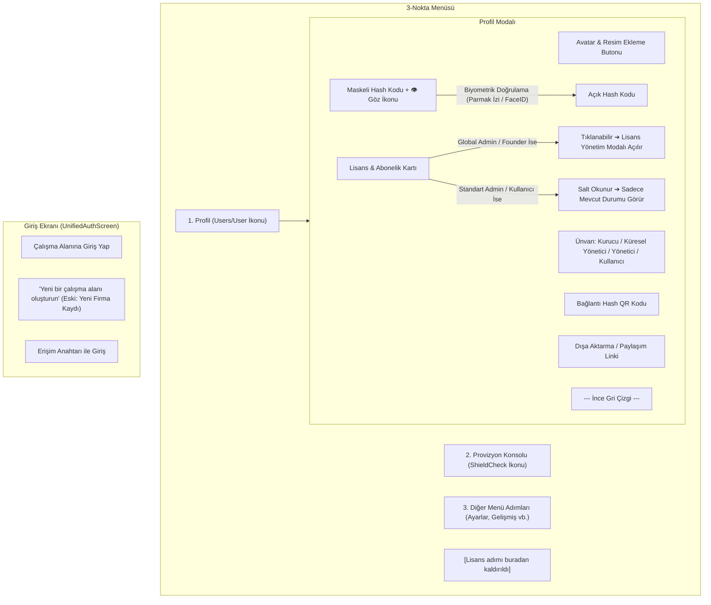

# 📋 Uygulama Planı: Profil Modalı, 3-Nokta Menüsü & Lisans Entegrasyonu

Bu plan; 3-nokta menüsünün yeniden düzenlenmesini, kapsamlı bir **Profil Modalı** oluşturulmasını, biyometrik doğrulama ile hash maskeleme/gösterme mekanizmasını, rol bazlı lisans görüntüleme/yükseltme akışını ve giriş kapısındaki metin revizyonunu kapsamaktadır.

---

## 🎯 1. Genel Mimari ve Gereksinimler

---

## 🛠️ 2. Yapılacak Değişiklikler ve Dosya Eşleştirmeleri

### Adım 1: İlk Uygulama Ekranındaki Metin Değişikliği
* **Dosya:** [`src/screens/auth/UnifiedAuthScreen.tsx`](file:///c:/whitedesk/src/screens/auth/UnifiedAuthScreen.tsx)
* **Değişiklik:**
  * Satır 430 civarındaki `"Yeni Firma Kaydı Yap"` ifadesi, talimat doğrultusunda **`"Yeni bir çalışma alanı oluşturun"`** olarak güncellenecek.
  * Dil dosyalarına (`src/locales/tr.json`, `en.json`) `"auth.hub.create_workspace": "Yeni bir çalışma alanı oluşturun"` / `"Create a new workspace"` anahtarları eklenecek/bağlanacak.

---

### Adım 2: 3-Nokta Menüsünün Güncellenmesi
* **Dosya:** [`src/components/helpdesk/modals/admin/AdminNavigationMenuModal.tsx`](file:///c:/whitedesk/src/components/helpdesk/modals/admin/AdminNavigationMenuModal.tsx)
* **Değişiklikler:**
  1. **Profil Adımı (En Başta):**
     * Hem Admin hem de Standart Kullanıcı menüsünde **en ilk sıraya** `"Profil"` eklenecek.
     * İkonu: Provizyon konsolundaki profil ikonu (`User` / `Users` - gri çizgisel).
     * Tıklandığında: `onOpenProfile()` callback'ini tetikleyecek.
  2. **Provizyon Konsolu İkonu:**
     * Provizyon Konsolu adımının ikonu gri çizgisel `ShieldCheck` (secure badge) olarak güncellenecek.
  3. **Lisans Adımı:**
     * 3-nokta menüsünden tamamen kaldırılacak (Profil ekranı içerisine taşınacak).

---

### Adım 3: Yeni Profil Modalı Bileşeni (`ProfileModal.tsx`)
* **Yeni Dosya:** `src/components/helpdesk/modals/identity/ProfileModal.tsx`
* **Bileşen Mimarisi:**
  1. **Profil Resmi Alanı:**
     * Yuvarlak baş avatar ikonu (varsayılan çizgisel User/Avatar silüeti).
     * Sağ alt köşesinde resim ekleme/seçme ikonu (`Camera` / `Plus`). `expo-image-picker` ile cihaz galerisinden resim seçebilme altyapısı.
     * Varsa seçilmiş profil resmi (`SafeSecureStore` veya yerel depolama), yoksa temiz baş ikonu.
  2. **Kullanıcı Ünvanı:**
     * `adminRole` ve `isAdmin` durumuna göre dinamik tespit:
       * `founder` veya WhiteID TheWhite ise: **"Kurucu"** (Founder)
       * `global_admin` veya master ise: **"Küresel Yönetici"** (Global Admin)
       * `admin` ise: **"Yönetici"** (Admin)
       * Normal kullanıcı (`none`) ise: **"Kullanıcı"** (User)
     * Ünvanın altında kullanıcının belirlediği özel rumuz (`customAlias` / ad-soyad).
  3. **Bağlantı Hash Kodu & QR Kodu:**
     * `react-native-qrcode-svg` ile `ownWhiteId` / bağlantı hash kodunu içeren yüksek kaliteli vektörel QR kod.
     * QR kodun altında maskeli hash gösterimi: `••••••••••••••••••••••••` veya `wh-••••••••••••`.
     * Yanında **Göz İkonu** (`Eye` / `EyeOff`):
       * Göz ikonuna tıklandığında `expo-local-authentication` tetiklenir (`LocalAuthentication.authenticateAsync`).
       * Cihaz biyometrisi (Parmak İzi / FaceID veya ekran kilidi PIN'i) doğrulandığında hash görünür hale gelir.
       * Başarısız olursa maskeli kalır ve hata/uyarı vermez.
  4. **Dışa Aktarma / Paylaşım Butonu:**
     * QR kod ve hash'in altına şık gri çizgisel `"Dışa Aktar / Paylaş"` butonu/linki (`Share` / `expo-sharing` ile bağlantı hash'ini dışarıya aktarma/panoya kopyalama).
  5. **İnce Gri Ayraç Çizgi:**
     * `borderBottomColor: '#E2E8F0', borderBottomWidth: 1, marginVertical: 16`.
  6. **Lisans & Abonelik Bölümü (En Altta):**
     * Hem kullanıcı hem yöneticilerde mevcuttur.
     * Kart üzerinde: Mevcut lisans tipi (Örn: *14 Gün Deneme*, *Pro*, *Kurumsal*), aktif operatör ve kullanıcı koltuk bilgisi.
     * **Yetki Kontrolü:**
       * Kullanıcı `isMasterAdmin` veya `isFounder` ise (`global_admin` / `founder`): Kart **tıklanabilir** (`ChevronRight` ile) ve tıklandığında mevcut `LicenseStationModal` açılır.
       * Standart admin veya normal kullanıcı ise: Kart **salt okunur** (tıklanamaz, sadece mevcut lisans durumunu gösterir).

---

### Adım 4: Konteyner ve Hook Entegrasyonu
* **Dosyalar:**
  * [`src/components/helpdesk/modals/HelpDeskModalsContainer.tsx`](file:///c:/whitedesk/src/components/helpdesk/modals/HelpDeskModalsContainer.tsx)
  * [`src/components/helpdesk/hooks/useHelpDeskModalsProps.ts`](file:///c:/whitedesk/src/components/helpdesk/hooks/useHelpDeskModalsProps.ts)
  * [`src/screens/HelpDeskScreen.tsx`](file:///c:/whitedesk/src/screens/HelpDeskScreen.tsx)
* **Entegrasyon Detayı:**
  * `profileModalVisible` durumu tanımlanacak.
  * 3-nokta menüsünden Profil tıklandığında `profileModalVisible = true` yapılacak.
  * Profil modalı içinden lisans kartına tıklandığında (Global admin için) `setAdminScreenType('license')` tetiklenecek.

---

## 🔒 3. Güvenlik ve Kriptografik Uyumluluk
* Biyometrik doğrulama cihazın Secure Enclave / Keystore donanım seviyesiyle çalışacak (`expo-local-authentication`).
* Bağlantı hash'i hiçbir şekilde üçüncü taraf sunuculara loglanmayacak; yalnızca yerel bellekte açılacak.
* Zero Personal Data politikamız gereği profil resmi yalnızca yerel cihaz deposunda tutulacaktır.

---

## 🚀 4. Doğrulama ve Test Adımları
1. **Tip Doğrulaması:** `npx tsc --noEmit` çalıştırılarak 0 hata ile geçtiği teyit edilecek.
2. **UI Testleri (Görsel ve Akış):**
   * Giriş ekranındaki buton metninin doğruluğu kontrol edilecek.
   * 3-nokta menüsünde "Profil"in en üstte olduğu, provizyon konsolunda `ShieldCheck` ikonu olduğu ve lisansın menüden kalktığı kontrol edilecek.
   * Profil modalında QR kod, maskeli hash, göz ikonuna tıklanınca biyometri tetiklenmesi kontrol edilecek.
   * Lisans kartının global adminde tıklanıp `LicenseStationModal`'ı açtığı, normal kullanıcıda salt okunur kaldığı test edilecek.

---

## 🔐 5. Profil QR (`wd_prof_...`) ve `wdrun` Yönetici Anahtarları Oturum Kurtarma Kuralı (KİLİTLİ SÜREÇ)

1. **Profil QR Kodu (`wd_prof_...`) ile Birebir Aynı Oturum Kurtarma:**
   * Profil modalında üretilen `wd_prof_<32hex>` kodu ([`getOrCreateProfilePasskey`](file:///c:/whitedesk/src/services/helpdesk/helpDeskAuthService.ts)), `whitedesk_recovery_hashes` tablosuna yalnızca firma ve rol bazında değil, doğrudan o yöneticinin/kullanıcının **`used_by_blind_id = myBlindId`**, `org_id` ve `app_id` değerleriyle kişiye özel olarak mühürlenir.
   * Yönetici telefonunu kaybettiğinde veya yeni bir cihaza geçtiğinde, sakladığı bu QR kodu (ilk açılış ekranından veya uygulama içinden) okuttuğunda ([`handleProfilePasskeyClaim`](file:///c:/whitedesk/src/services/helpdesk/helpDeskAuthService.ts) & [`claimUnifiedHash`](file:///c:/whitedesk/src/services/helpdesk/helpDeskLicenseService.ts)), yeni cihazda rastgele bir kimlik oluşturulmaz; `used_by_blind_id` içindeki **orijinal `blind_id`**, `whitedesk_admins` üzerindeki **`alias` (Ad Soyad / Rumuz)**, **rol** ve **departman (`org_id`)** bilgileri yeni cihazın `OWN_WHITE_ID` ve kurumsal oturumuna birebir geri yüklenir.
2. **`wdrun` Admin Anahtarlarının İlk Giriş ve Bilet Kutusu (`admin <kod>`) Tam Uyumu:**
   * `wdrun` üzerinde firma seçilerek üretilen `ga_cosmos_...`, `adm_oper_...`, `tw_founder_...` anahtarları veya doğrudan eklenen `blind_...` yönetici kimlikleri; hem ilk ana girişteki **"Kod ile Giriş Yap" (`Giriş Kodunuz`)** kutusundan hem de bilet mesaj kutusundan **`admin <kod/blind_id>`** komutuyla girildiğinde aynı deterministik `blind_id` kimliğini (`OWN_WHITE_ID`) mühürler ve onaya düşürmeden yönetici oturumunu doğrudan açar.

