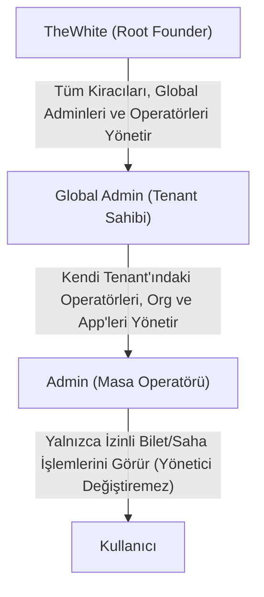

# Provizyon Konsolu: Uzun Basma Bağlamsal Eylem Matrisi & RBAC Planı

Bu belge, **Provizyon Konsolu** (`ProvisioningConsoleModal`) üzerindeki 4 ana satırda (Yönetici, Organizasyon, Uygulama, Kategori) kartlara **uzun basıldığında (Long Press)** açılacak bağlamsal eylemleri, yetki hiyerarşisini (RBAC) ve Samsung One UI aksiyon sayfası mimarisini tanımlar.

---

## 1. Rol ve Yetki Hiyerarşisi (RBAC Matrisi)

İşlemler, işlemi yapan kullanıcının rolüne göre sıkı biçimde sınırlandırılır:



| Aktif Kullanıcı Rolü | Hedef Öğe | İzin Verilen Eylemler | Kısıtlanan / Yasak Eylemler |
| :--- | :--- | :--- | :--- |
| **TheWhite (Founder)** | Tüm Adminler, Kiracılar, Orglar, App'ler | **Tam Yetki:** Revoke, Org/App Değiştirme, Yetki Kaldırma, Silme, Rol Değiştirme | Kendi root hesabını silemez |
| **Global Admin** | Kendi Tenant'ındaki Adminler (Operatörler) | • Org Değiştirme<br>• App Değiştirme<br>• Revoke (Askıya Al)<br>• Yetki Kaldırma / Silme | • TheWhite (Founder) kartına dokunamaz<br>• Kendisini silemez / yetkisini düşüremez |
| **Admin (Operatör)** | Diğer Adminler | Yalnızca profili / alias'ı görüntüleme | Yönetici silemez, Org/App taşıyamaz, Revoke edemez |

---

## 2. Kart Bazında Uzun Basma Eylem Kataloğu

### 👤 2.1. YÖNETİCİ KARTINA UZUN BASMA (`admin`)
Yönetici kartına basılı tutulduğunda One UI stilinde açılan bağlamsal menü:

```
┌────────────────────────────────────────────────────────┐
│  Ahmet Yılmaz (Operatör)                               │
│  bod_8f2a... • Teknik Servis                           │
├────────────────────────────────────────────────────────┤
│  🏢  Organizasyon Değiştir (Org Ata)                   │
│      Operatörü başka bir departmana/sahaya bağlayın    │
│                                                        │
│  📱  Uygulama Değiştir (App Ata)                       │
│      Operatörün yetkili olduğu uygulamayı sınırlandırın│
│                                                        │
│  ⏸️  Erişimi Askıya Al (Revoke / Dondur)               │
│      Hesabı silmeden geçici olarak pasife alın         │
│                                                        │
│  🗑️  Yönetici Yetkisini Kaldır (Sil)                   │
│      Operatör koltuğunu iptal edin (Çift Onay)         │
└────────────────────────────────────────────────────────┘
```

#### Eylem Detayları:
1. **Organizasyon Değiştir (`onMoveAdminOrg`):**
   - Hedef Birim Seçici (`MoveTargetPicker`) açılır:
     - `[Firma Seviyesi - Bağımsız]`
     - Mevcut `whitedesk_orgs` listesi (`Teknik Servis`, `Depo`, `Muhasebe` vb.).
   - Seçilen `org_id`, `whitedesk_admins` veya `whitedesk_admin_alloc` tablosuna anında güncellenir.
2. **Uygulama Değiştir (`onMoveAdminApp`):**
   - Hedef Uygulama Seçici açılır:
     - `[Tüm Uygulamalar - Genel]`
     - Mevcut `whitedesk_app_cat` listesi (`InWhite Core`, `Saha Takip` vb.).
   - Seçilen `app_id` güncellenir.
3. **Erişimi Askıya Al / Aktifleştir (`onToggleAdminStatus`):**
   - `is_active = !is_active` toggle işlemi.
   - Pasif edilen admin bilet yanıtlayamaz, kartında gri `[Askıda]` rozeti çıkar.
4. **Yönetici Yetkisini Kaldır (`onDeleteAdmin`):**
   - Kırmızı ikazlı **BottomConfirmationSheet** devreye girer.
   - Onaylandığında `whitedesk_admins` tablosundan kaldırılır; lisans koltuğu boşa çıkar.

---

### 🏢 2.2. ORGANİZASYON KARTINA UZUN BASMA (`org`)
Birim kartına basılı tutulduğunda:

```
┌────────────────────────────────────────────────────────┐
│  Teknik Servis & Saha                                  │
│  Birim ID: org_teknik_01 • 3 Admin • 2 App             │
├────────────────────────────────────────────────────────┤
│  ✏️  Yeniden Adlandır (Düzenle)                        │
│      Birimin görünen adını güncelleyin                 │
│                                                        │
│  🗑️  Organizasyonu Sil                                 │
│      Birimi ve bağlı olmayan ilişkileri kaldırın       │
└────────────────────────────────────────────────────────┘
```

#### Eylem Detayları:
1. **Yeniden Adlandır (`onRenameOrg`):** Tek satırlık One UI prompt modal açılır, `name` güncellenir.
2. **Organizasyonu Sil (`onDeleteOrg`):**
   - **Güvenlik Kontrolü:** Eğer bu org'a atanmış admin veya app varsa kullanıcı uyarılır:
     > *"Bu birime bağlı 3 yönetici ve 2 uygulama bulunmaktadır. Birimi sildiğinizde bu öğeler Firma Seviyesine (Genel) aktarılacaktır."*
   - Onay verildiğinde `whitedesk_orgs` tablosundan silinir ve bağlı öğelerin `org_id`si `default`a çekilir.

---

### 📱 2.3. UYGULAMA KARTINA UZUN BASMA (`app`)
Uygulama kartına basılı tutulduğunda:

```
┌────────────────────────────────────────────────────────┐
│  Saha Takip SDK (InWhite)                              │
│  App ID: app_field_ops • Bağlı Org: Lojistik           │
├────────────────────────────────────────────────────────┤
│  🏢  Organizasyon Değiştir (Birim Taşı)                │
│      Uygulamayı başka bir birime atayın veya bağımsız  │
│      seviyeye çekin                                    │
│                                                        │
│  ⚠️  Entegrasyonu Kaldır (Revoke SDK Bridge)           │
│      API anahtarını geçersiz kılın ve köprüyü kesin    │
└────────────────────────────────────────────────────────┘
```

#### Eylem Detayları:
1. **Organizasyon Değiştir (`onMoveAppOrg`):**
   - Seçici açılır: Hedef Org seçilir veya Firma Seviyesi atanır.
2. **Entegrasyonu Kaldır (`onRevokeApp`):**
   - Çift onay sheet'i: *"Uygulamanın SDK köprü anahtarı ve WhiteDesk bağlantısı kalıcı olarak kaldırılacaktır. Onaylıyor musunuz?"*
   - Onaylanınca `whitedesk_app_cat` ve SDK tablolarından revoke edilir.

---

### 🏷️ 2.4. KATEGORİ KARTINA UZUN BASMA (`cat`)
Kategori kartına basılı tutulduğunda:

```
┌────────────────────────────────────────────────────────┐
│  Donanım Arızası                                       │
│  Kategori ID: cat_hardware                             │
├────────────────────────────────────────────────────────┤
│  🔗  Seçili Birime / Uygulamaya Ata                    │
│      Provizyon ekranında seçili olan Org/App'e bağlar  │
│                                                        │
│  🗑️  Kategoriyi Sil                                    │
│      Bilet kategorisini sistemden kaldırın             │
└────────────────────────────────────────────────────────┘
```

---

## 3. UI/UX: Samsung One UI Eylem Sayfası Standartları

1. **Köşeler ve Yükseklik:** `borderTopLeftRadius: 28`, `borderTopRightRadius: 28`, One UI sürükleme çubuğu.
2. **Hiyerarşik İkon Renkleri:**
   - Taşıma / Değiştirme eylemleri: **Cobalt Mavi** (`#1B64DA`)
   - Duraklatma / Askıya Alma: **Amber Sarı** (`#D97706`)
   - Yetki Kaldırma / Silme: **Kırmızı** (`#DC2626`)
3. **Çift Onay Koruması:** Admin kaldırma, Org silme ve App revoke işlemleri doğrudan silinmez; mutlaka **BottomConfirmationSheet** üzerinden ikinci onayla işlenir.

---

## 4. Uygulama Adımları

1. **Adım 1:** `ProvisioningConsoleModal.tsx` içindeki `longPressItem` menüsünü genişleterek `admin` için "Org Değiştir", "App Değiştir", "Askıya Al (Revoke)" ve "Yetkiyi Kaldır" seçeneklerini eklemek.
2. **Adım 2:** `helpDeskService.ts` üzerinde eksik olabilecek `toggleAdminActiveStatus`, `updateAdminAllocation`, `updateOrgName` yardımcı fonksiyonlarını tamamlamak.
3. **Adım 3:** `TypeScript` kontrolü (`npx tsc --noEmit`) ile sıfır hata doğrulaması yapmak.
