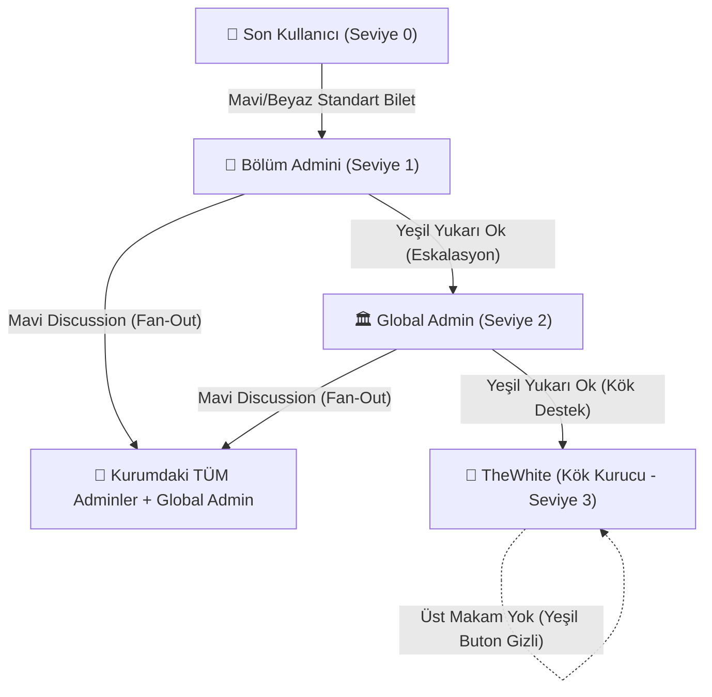

# 🏛️ WhiteDesk: Bilet Türleri, Roller ve Hiyerarşik Dağıtım Şartnamesi (Master Matrix)

Bu doküman; WhiteDesk sıfır-bilgi (Zero-Knowledge, E2EE) mimarisinde kullanıcılar, bölüm yöneticileri, kurum yöneticileri ve kurucu makam arasındaki bilet türlerini, renk kodlarını, açılış tetikleyicilerini ve kriptografik yönlendirme kurallarını tek bir çatı altında toplar.

---

## 👥 1. Rol ve Egemenlik Seviyeleri (Role Hierarchy)

| Seviye | Rol Adı | Sistem Tanımı | Kapsam & Yetki | Bilet Açma Yetkisi |
| :---: | :--- | :--- | :--- | :--- |
| **0** | **Son Kullanıcı** | `user` | Kurum personeli veya harici müşteri. | Kendi kurumunun bölüm adminlerine standart destek bileti açar. |
| **1** | **Bölüm Admini (Operatör)** | `admin` | Belirli departman (`category`), birim (`org_id`) ve uygulama (`app_id`) yetkilisi. | 1. Kurum içi tüm adminlere **Mavi Tartışma (Discussion)**<br>2. Kurumunun Global Admin'ine **Yeşil Destek Bileti**. |
| **2** | **Global Admin** | `global_admin` | İlgili kiracının (tenant) en üst kurum yöneticisi. | 1. Kurum içi tüm adminlere **Mavi Tartışma (Discussion)**<br>2. Kök kurucu makama (**TheWhite**) **Yeşil Destek Bileti**. |
| **3** | **Kurucu (TheWhite)** | `founder` / `isMasterAdmin` | Sistemin kök egemen makamı. Tüm kiracıların üstündedir. | Üst makam olmadığı için yeşil buton gizlidir. Dilediği tenant'a geçip operasyon/tartışma yönetebilir. |

---

## 🎫 2. Master Bilet Türleri ve Yönlendirme Matrisi



### 📊 Detaylı Süreç ve Dağıtım Tablosu

| Bilet Türü & Rengi | Kim Açar? | Nasıl Açılır? (UI Tetikleyici) | Kime / Kimlere Gider? | Kriptografik Dağıtım Modeli | Amacı & Süreci |
| :--- | :--- | :--- | :--- | :--- | :--- |
| **Standart Destek Bileti**<br>*(Mavi / Beyaz)* | **Son Kullanıcı** (`user`) | Ana ekrandaki mavi **"+" / "Yeni Bilet"** butonu (`onNewTicketPress`) | Seçilen kategoriye göre **ilgili Bölüm Adminine** (`admin`) | **Adil Dağıtım (Load-Balance):**<br>D1 `admin_roster` taranır; en düşük sayaçlı ve en az biletli aktif operatörün `blind_id`'sine şifrelenir. | Kullanıcının operasyonel sorunlarının (arıza, soru, talep) uzman tarafından çözülmesi. SLA aşımında ikiz biletle devredilir. |
| **İç Tartışma Bileti**<br>*(Mavi Discussion)* | **Bölüm Admini** (`admin`) | Ana ekrandaki mavi **"+" / "Yeni Bilet"** butonu (`isAdmin = true` iken `isDiscussion = true` olur) | O kurumdaki **TÜM Bölüm Adminleri + Global Adminler** | **Çoklu Dağıtım (Fan-Out):**<br>`getEnterpriseAdmins` ile kurumun tüm adminleri çekilir; her yöneticinin `blind_id`'sine ayrı bir şifreli kopya D1'e atılır. | Kurum içi teknik istişare, nöbet devri, ortak vaka analizi. Müşteriye/kullanıcıya kapalıdır. Çeken adminin kopyası ACK ile buharlaşır. |
| **Yönetici Duyuru Bileti**<br>*(Mavi Discussion)* | **Global Admin** (`global_admin`) | Ana ekrandaki mavi **"+" / "Yeni Bilet"** butonu (`isAdmin = true` iken `isDiscussion = true` olur) | O kurumdaki **TÜM Bölüm Adminleri + Diğer Global Adminler** | **Çoklu Dağıtım (Fan-Out):**<br>Global Admin hariç firmanın tüm aktif yöneticilerinin `blind_id`'lerine ayrı ayrı şifreli paket gider. | Kurumsal duyurular, operasyonel direktifler, bakım bildirimleri. Tüm masa ortak sohbet alanında toplanır. |
| **Hiyerarşik İç Eskalasyon**<br>*(Yeşil Yukarı Ok)* | **Bölüm Admini** (`admin`) | Bilet listesinde sağ alttaki **Yeşil Yukarı Oklu** buton (`supportTicketTarget = 'global_admin'`) | Kurumun **Global Adminlerine** (`global_admin`) | **Global Admin Fan-Out:**<br>Yalnızca `role = 'global_admin'` olan yöneticilerin `blind_id`'lerine şifreli olarak ulaştırılır. | Operatörün aşamadığı yetki talepleri, çift onay gerektiren işlemler, kurum içi idari onaylar. |
| **Kök Mimari Destek**<br>*(Yeşil Yukarı Ok)* | **Global Admin** (`global_admin`) | Bilet listesinde sağ alttaki **Yeşil Yukarı Oklu** buton (`supportTicketTarget = 'thewhite'`) | Doğrudan **TheWhite Kök Makamına** (`blind_thewhite_root`) | **Kök Şifreleme (Strictly Confidential):**<br>Doğrudan `blind_thewhite_root` açık anahtarıyla şifrelenir. Alt adminler veya diğer tenant'lar asla göremez. | Tenant lisans yükseltme, kurumsal şema/altyapı tıkanıklıkları, çekirdek mimari ve sunucu desteği. |
| **Kurucu Makam**<br>*(TheWhite)* | **TheWhite** (`founder`) | Yeşil buton **GİZLİDİR** (Üst makam yoktur). Mavi butonla tenant içi bilet açabilir. | Seçtiği Kiracının Adminlerine veya Doğrudan Kullanıcıya | **Kök Egemen Müdahale:**<br>TheWhite provizyon konsolundan hangi firmayı seçerse o firmanın en üst yetkilisi olarak bilet açar. | Ekosistem genel denetimi, kriz anı müdahalesi, küresel kurumsal koordinasyon. |

---

## 🎨 3. Ana Ekran 3 Buton Sadeleştirme Standardı (Kilitli Tasarım)

Karışıklığı önlemek ve uzun basmalı gizli menü bağımlılığını ortadan kaldırmak için ana ekrandaki butonlar 3 net renk ve kurala bağlanmıştır:

| Buton Rengi | Buton Adı & Metni | Kimlerde Görünür? | İkon Düzeni (Sol / Sağ) | Yön Okunun Anlamı | Tetiklediği Eylem |
| :--- | :--- | :--- | :--- | :--- | :--- |
| **1. MAVİ**<br>`#3B82F6` | **Yeni bir bilet oluştur**<br>*(Create a new ticket)* | **Kullanıcı**, **Admin**, **Global Admin**<br>*(Kurucuda ASLA bulunmaz)* | **Sol:** `Plus`<br>**Sağ:** `ArrowUp` *(Herkeste yukarı ok)* | Her zaman hiyerarşide **yukarıya** doğru bir bilet açıldığını belirtir: Kullanıcı ➔ Admin'e, Admin ➔ Global Admin'e, Global Admin ➔ TheWhite'a. | Destek bilet ekranını açar (`supportTicketTarget` hedefine göre şifrelenir). |
| **2. MOR**<br>`#7C3AED` | **Bir tartışma başlat**<br>*(Start a discussion)* | **Admin**, **Global Admin**, **Kurucu (TheWhite)**<br>*(Kullanıcıda bulunmaz)* | **Sol:** `MessageSquare` / `Plus`<br>**Sağ:** Role göre değişen oklar: | • **Kurucu & Global Admin:** `ArrowDown` *(Aşağı ok: alt kadrolara talimat/tartışma)*<br>• **Admin:** `ArrowRight` + `ArrowUp` *(Sağa yatay ok: operatör arkadaşlarına; Yukarı ok: Global Admin'e)* | Ortak iç istişare / telsiz odası biletini fırlatır (`is_discussion = true`, fan-out). |
| **3. YEŞİL**<br>`#16A34A` | **Bir telsiz yayını başlat**<br>*(Start a radio broadcast)* | **Herkeste Var**<br>*(Lisans aktif ve PTT yetkisi varsa)* | **Sol:** `Radio` *(Sol ikonlu)*<br>**Sağ:** **OKSUZ** | Canlı ses ağına (WebRTC PTT) bağlanır, hiyerarşik bilet akışı değildir. | Kuruluşun/birimin canlı telsiz frekansına bağlanır. |

---

## 🏷️ 4. Bilet Numaralandırma ve Kimlik Standardı (`TKT-` vs `DSC-`)

Bilet kartlarında görsel karmaşayı önlemek, derecelendirme/yıldız algısı karışıklığını sıfırlamak ve arama çubuğunda doğal filtreleme sağlamak için bilet numaraları oluşturulma türüne göre ikiye ayrılmıştır:

* **`TKT-XXXXXX` (Standart Destek Bileti):**
  - Mavi butonla açılan son kullanıcı talepleri, iç eskalasyonlar ve TheWhite kök destek talepleri için üretilir (Örn: `TKT-7K9M2P`).
* **`DSC-XXXXXX` (İç Tartışma / İstişare Bileti):**
  - Mor butonla açılan tüm yönetici tartışmaları ve duyuruları için üretilir (Örn: `DSC-8F2A19`).
* **Sıfır İkon Sadelik İlkesi:** Bilet numarasının başında `DSC-` veya `TKT-` açıkça yer aldığı için bilet kartında yıldız veya ek yapay rozetlere gerek kalmaz; arayüz saf, minimalist ve profesyonel kalır.
* **Birim (ORG) Gösterim Kuralı:** Bilet numarasının sağına kesinlikle **kategori yazılmaz**; doğrudan biletin bağlı olduğu **Birim / Departman (ORG: Saha, Muhasebe, Lojistik vb.)** yazılır:
  - `TKT-7K9M2P · Saha`
  - `TKT-4892A1 · Muhasebe`
  - `DSC-8F2A19 · Saha` (veya `DSC-8F2A19 · Genel Merkez`)

---

## 👤 5. Bilet Kartı Kimlik, Oluşturan, Temsilci ve Tarih Mimarisi (Kilitli Tasarım)

Bilet kartında hem bileti açan kullanıcının/yöneticinin hem de bilete atanan temsilcinin kimliği ve zaman damgaları birbirine karışmaması için **iki ayrı ardışık satırda** yer alır:

```text
TKT-SG9NW3 · Saha                                        [ Açık ]  ⋮
Rd ticket
☆ 1f8b4d...7365f · 04 Kas 2026 14:10
👤 8294f4...52123 · 04 Kas 2026 15:47                    [☁️] [🍃 2g]
```

* **1. Oluşturan Satırı (Atanan satırından bir önceki satır, en başta — Pill Yok, Gri):**
  - Kesinlikle pill (kutu/çerçeve) içerisine alınmaz; yalın metin olarak yazılır.
  - Satırın en solunda **içi boş yıldız (`Star`)** ikonu, yanında oluşturanın adı-soyadı (veya Blind ID'si), ` · ` ayracı ve sabit **oluşturma tarihi-saati (`ticket.created_at`)** yer alır. Bu tarih biletin doğum anıdır ve asla değişmez.
* **2. Temsilci / Havuz Satırı (Son satır / Google M3 Alt Barı — Pill Yok, Mavi `#2563EB`):**
  - Sol tarafta **kesinlikle pill (kutu/çerçeve) olmadan** mavi (`#2563EB`) kullanıcı (`User`) ikonu ve mavi atanan temsilci (veya `Havuzda`) yer alır.
  - Hemen sağında ` · ` ayracı ve **sahiplik/atama tarihi-saati (`ticket.assigned_at`)** yer alır:
    1. **İlk Açılış (Havuz veya Doğrudan Atama):** Havuza giriş veya ilk atama tarihi-saati (`created_at` ile eşzamanlı başlar).
    2. **Havuzdan Devralma (`claimEscalatedTicket`):** Adminin bileti havuzdan çektiği tarih ve saat.
    3. **SLA Zaman Aşımı Devri (`slaEscalationService`):** Biletin yeni admine veya eskalasyon havuzuna devredildiği tarih ve saat.
    4. **Adminler Arası Transfer (`acceptTicketTransfer`):** Devralan adminin transferi kabul ettiği tarih ve saat.
  - **Mesajlaşma Kuralı:** Normal mesaj yanıtları (`ticket_reply`) kart üzerindeki `created_at` veya `assigned_at` tarihlerini **asla değiştirmez**. Mesajların kendi saatleri yalnızca bilet detayındaki sohbet balonlarında takip edilir (arka plandaki `updated_at` yalnızca ana listede aktif bileti en üste sıralamak için güncellenir).
* **İki Kelime Kuralı (Ad Soyad Zorunluluğu):**
  - Kuruluş ayarlarında `allowNameEntry` aktif edildiğinde, kullanıcılar profil veya ana ekrandan ad ve soyadlarını en az iki kelime olarak (nokta vb. karakterlerle geçiştirilemez) girmek zorundadır.
* **Oluşturan ve Temsilci Blind ID Gösterim Standardı (`formatDisplayBlindId`):**
  - Kullanıcı veya temsilci isim girmişse doğrudan ad-soyad gösterilir.
  - İsim girilmemişse veya anonim ise, her iki alanda da Blind ID şu formatta maskelenerek gösterilir:
    $$\text{Örnek: } 124495...77343$$
    - `blind_` ön eki kaldırılır.
    - İlk 6 karakter alınır (`124495`).
    - 7., 8. ve 9. karakterler yerine `...` (3 nokta) konur.
    - 10. ile 14. karakterler aralığı eklenir (`77343`).
* **Temsilci Havuz Kuralı:** Bilet henüz bir temsilciye atanmamışsa temsilci alanında "Havuzda" ifadesi yer alır; kesinlikle buton veya geçersiz rozet kullanılmaz.

---

## 🔒 6. Güvenlik, İzolasyon ve Kriptografik Kurallar

1. **Multi-Tenant İzolasyon Duvarı:**
   - Hiçbir bilet (Discussion dahil) başka bir kiracının (`enterprise_blind_id`) sınırını aşamaz.
   - Sadece TheWhite makamı kiracılar üstü bağımsız kök otorite olarak dilediği kiracının masasını yönetebilir.

2. **Sıfır Sunucu İzi (Zero-Knowledge Multi-Recipient Fan-Out):**
   - Global Adminlere veya tüm adminlere gidecek biletlerde sunucuda **sahte/ortak bir havuz ID'si barındırılmaz**.
   - Bilet oturum anahtarı istemcide her yöneticinin kişisel açık anahtarıyla tek tek zarflanır (`recipient_blind_id: adm.blind_id`).
   - Her yönetici kendi kopyasını çektiğinde paket D1'den ACK ile buharlaşır.

3. **Discussion ve Destek Ayrımı:**
   - **Mavi Buton (`is_discussion = true`):** Yatay ve dikey tüm kadroyu kapsayan ortak telsiz odasıdır.
   - **Yeşil Buton (`supportTicketTarget`):** Sadece bir üst amire yönlenen resmi, hiyerarşik kurumsal destek hattıdır.

---

## 🔗 7. İlgili Doküman Bağlantıları (Cross-References)

* **Bilet Dağıtımı & SLA Kuralları:** [Ticket_alloc_revoke.md](./Ticket_alloc_revoke.md)
* **Teknik Kodlama Yol Haritası:** [ticket_alloc_revoke_implementation_plan.md](./ticket_alloc_revoke_implementation_plan.md)
* **Arayüz ve Başlık Standartları:** [compose_header_plan.md](./compose_header_plan.md)
* **Gelişmiş Mimari ve Buton Kuralları:** [advanced_architecture_and_ui_plan.md](./advanced_architecture_and_ui_plan.md)
* **Bilet Süreçleri ve Metin Standartları:** [ticket_processes_and_texts_plan.md](./ticket_processes_and_texts_plan.md)
* **Master Dokümantasyon İndeksi:** [README.md](./README.md)
