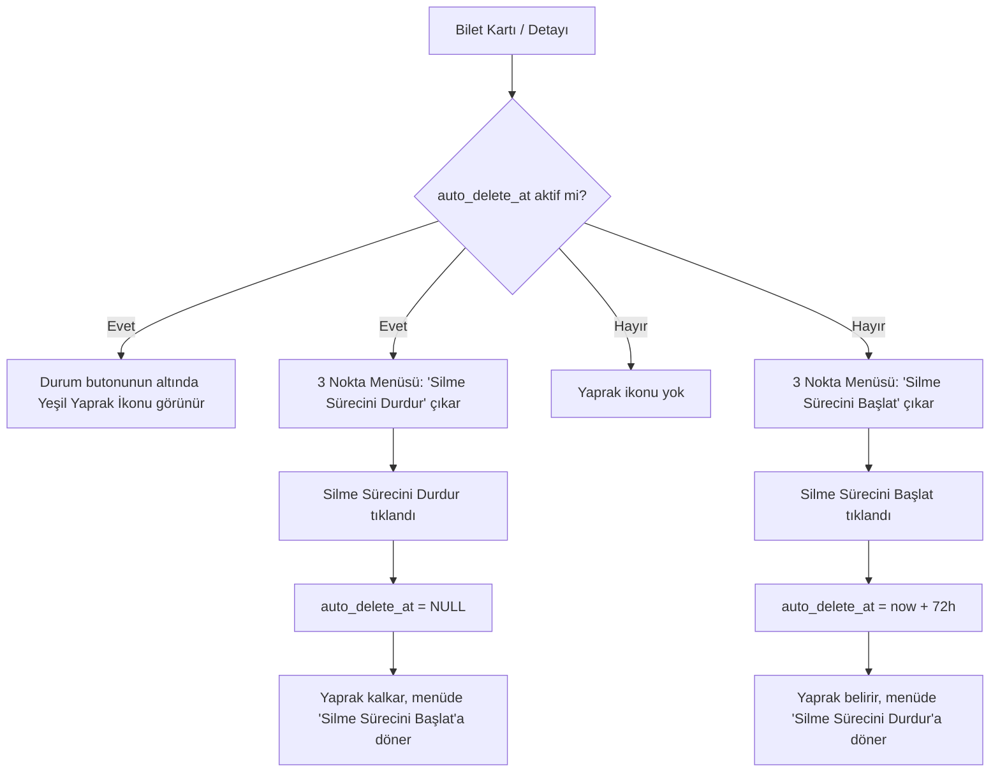

# WhiteDesk Bilet Süreçleri & Sadeleştirilmiş Metinler Planı

## 1. Kök Neden Analizi (Sürecin Çalışmama & Tekrarlama Nedeni)

### Teşhis Edilen Kritik Hatalar:
1. **SQL SELECT Eksikliği (`helpDeskService.ts`):**
   - `getTickets` fonksiyonundaki 4 farklı SQL sorgusunda (`isFounder`, `isGlobalAdmin`, `normal admin`, `user`) `auto_delete_at` alanı `SELECT` edilmiyor.
   - Dönen satırlar `HelpDeskTicket` objesine dönüştürülürken `auto_delete_at` alanı `undefined` kalıyor.
   - **Sonuç:** Bilet veritabanına kaydedilse bile liste her yenilendiğinde `auto_delete_at` silinmiş gibi görünüyor; yeşil yaprak kayboluyor ve menüde süreç hiç başlamamış gibi tekrar "Silme Sürecini Başlat" seçeneği çıkıyor.

2. **Veritabanı Şeması Eksikliği (`ensureSchema`):**
   - `whitedesk_tickets` tablosu oluşturulurken `auto_delete_at BIGINT` kolonu DDL içinde ve `ALTER TABLE` komutlarında tanımlanmamış.
   - Bu nedenle `UPDATE whitedesk_tickets SET auto_delete_at = ...` sorgusu Neon veritabanında kolon bulunamadığı için sessizce başarısız oluyor.

3. **Menü State Senkronizasyonu (`targetActionTicket`):**
   - Menü açıldığında `targetActionTicket` güncel `tickets` state'inden en son `auto_delete_at` değerini referans almalıdır.

---

## 2. Menü Seçenekleri (Kesin Kural)

3 nokta menüsündeki menü seçenekleri doğrudan kullanıcının belirlediği standartta olacaktır:

| Bilet Durumu | 3 Nokta Menü Seçeneği | Açıklaması |
| :--- | :--- | :--- |
| **Süreç Aktif Değilse** | **`Silme Sürecini Başlat`** | 72 saatlik dijital temizlik sayacını devreye alır. |
| **Süreç Aktif İse** | **`Silme Sürecini Durdur`** | Aktif silme sayacını durdurur ve bileti saklar. |

> [!IMPORTANT]
> Süreci başlayan bilette **"Silme Sürecini Başlat" seçeneği ASLA görünmeyecek**, doğrudan **"Silme Sürecini Durdur"** seçeneği yer alacaktır. Süreç durdurulduğunda ise tekrar **"Silme Sürecini Başlat"** seçeneğine dönecektir.

---

## 3. Sadeleştirilmiş Yeni Metin Seti

### A. Kapatma / Çözüm Onayı Modalı (`checkTicketResolutionStatus`)
* **Başlık:** `#{ticketCode} Çözüldü mü?` *(Örn: `#c88cfb75 Çözüldü mü?`)*
* **Açıklama:**
  > "Uzmanımızın yanıtı sorununuzu çözdüyse bileti kapatabilir, ek sorunuz varsa görüşmeye devam edebilirsiniz."
* **Butonlar:**
  * **Onay:** `Çözüldü, Kapat` *(Yeşil)*
  * **İptal:** `Devam Et` *(Doğrudan bilet detayına yönlendirir)*

---

### B. Hizmet Deneyimi & Değerlendirme Modalı (`TicketFeedbackDialog`)
* **Başlık:** `Hizmeti Değerlendirin`
* **Alt Başlık:** `Destek kalitemizi 1-5 arasında puanlayın.`
* **Görüş Alanı (Placeholder):** `Görüşünüz (isteğe bağlı)...`
* **Gizlilik Notu:** `Uçtan uca şifreli ve sıfır kişisel veri güvenceli.`
* **Eylem Butonu:** `Puanla`
* **Başarı Bildirimi Sheet'i:**
  * **Başlık:** `Puanınız Kaydedildi`
  * **Açıklama:** `Geri bildiriminiz için teşekkür ederiz.`

---

### C. Dijital Temizlik & Silme Süreci Modalları (`showDigitalCleanProposal` / `handleStopAutoDelete`)

#### 1. Silme Süreci Başlatma Onay Modalı:
* **Başlık:** `Silme Sürecini Başlat`
* **Açıklama:**
  > "Bilet ve ekleri 72 saat sonra yerel depolama ve sunucudan kalıcı olarak silinsin mi?"
* **Butonlar:**
  * **Onay:** `Sayacı Başlat (72s)` *(Yeşil)*
  * **İptal:** `Sakla`

#### 2. Sayaç Başlatıldı Bilgilendirmesi:
* **Başlık:** `Silme Süreci Başlatıldı`
* **Açıklama:** `Bilet 72 saat sonra silinecektir. Dilediğinizde menüden durdurabilirsiniz.`
* **Buton:** `Tamam`

#### 3. Silme Sürecini Durdurma Onay Modalı:
* **Başlık:** `Silme Sürecini Durdur`
* **Açıklama:** `72 saatlik silme sayacını durdurup bileti saklamak istiyor musunuz?`
* **Butonlar:**
  * **Onay:** `Sayacı Durdur` *(Kırmızı)*
  * **İptal:** `Vazgeç`

#### 4. Sayaç Durduruldu Bilgilendirmesi:
* **Başlık:** `Silme Süreci Durduruldu`
* **Açıklama:** `Biletiniz saklanmaya devam edecektir.`
* **Buton:** `Tamam`

---

## 4. UI ve Durum Mantığı (State & Akış)

### Yetki ve Rol Kuralları:
1. **Otomatik Teklif:** Yalnızca kullanıcı biletini kapattığında çıkar. Admin kapatırken otomatik teklif çıkmaz.
2. **Admin Menüsü:**
   - Admin biletin 3 nokta menüsünden süreci başlatabilir (**"Silme Sürecini Başlat"**) veya durdurabilir (**"Silme Sürecini Durdur"**).
   - Admin için menüde ayrıca **"Bileti Doğrudan Sil"** kalıcı silme seçeneği her zaman yer alır.
3. **Eşzamanlı Görünüm:** Kullanıcı veya admin süreci başlattığında veritabanı güncellendiği için her iki tarafta da liste yenilendiğinde yeşil yaprak kalıcı olarak görünür.

---

## 5. Uygulama Adımları

1. **`src/services/helpDeskService.ts`:**
   - `ensureSchema` içerisine `ALTER TABLE whitedesk_tickets ADD COLUMN IF NOT EXISTS auto_delete_at BIGINT;` eklenmesi.
   - `getTickets` içerisindeki tüm `SELECT` sorgularına `auto_delete_at` kolonunun eklenmesi ve map fonksiyonunda `auto_delete_at: r.auto_delete_at ? Number(r.auto_delete_at) : null` olarak atanması.
   - `scheduleTicketAutoDelete` ve `cancelTicketAutoDelete` çağrılarında SQL dönüşünün ve state'in doğrulanması.

2. **`src/components/helpdesk/modals/TicketActionModal.tsx`:**
   - Menü seçenek başlıklarının tam olarak **"Silme Sürecini Başlat"** ve **"Silme Sürecini Durdur"** olarak güncellenmesi.
   - `ticket.auto_delete_at` denetiminin doğrudan `Boolean(ticket.auto_delete_at && Number(ticket.auto_delete_at) > 0)` olarak bağlanması; süreç başlamış bilette başlat seçeneğinin kesinlikle gizlenip sadece durdur seçeneğinin gösterilmesi.

3. **`src/screens/HelpDeskScreen.tsx` & `TicketFeedbackDialog.tsx`:**
   - Sadeleştirilmiş kısa ve vurucu metinlerin uygulanması.
   - `scheduleTicketAutoDelete` ve `cancelTicketAutoDelete` sonrasında `loadData()` çağrılarak güncel listenin anında Neon'dan taze çekilmesi.

4. **Derleme & Kurulum:**
   - Offline JS bundle üretimi (`expo export:embed`).
   - Gradle derlemesi (`assembleDebug`).
   - Telefon ve tablete yüklenip test edilmesi.
